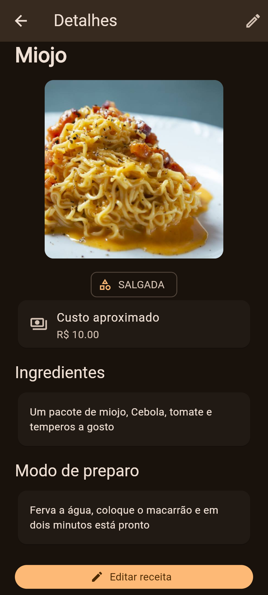
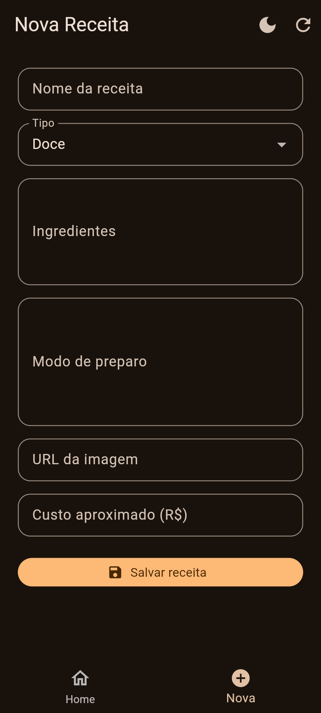
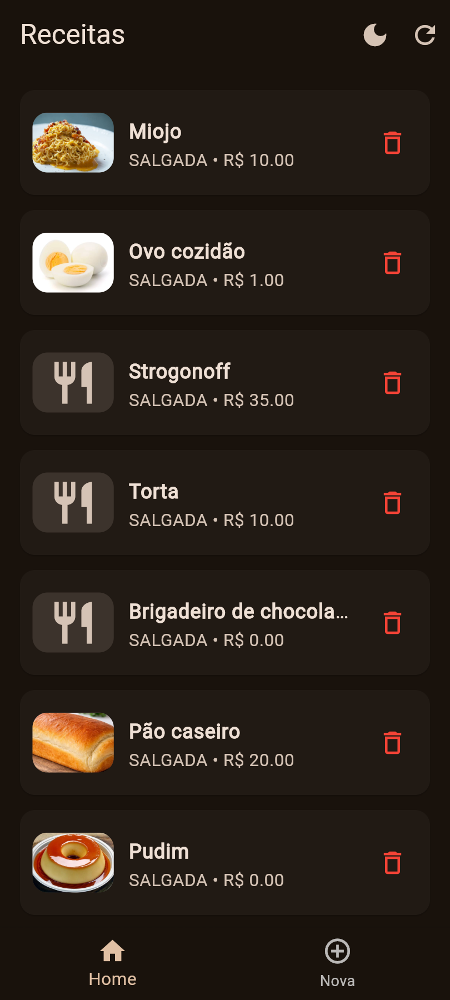

# flutter_receitas

Aplicativo desenvolvido em Flutter,livro de Receitas implantada na Vercel.

📱 Prints

<table>
<tr>
<td></td>
<td></td>
</tr>
<tr>
<td></td>
</tr>
</table>

## 🛠️ Tecnologias

- Flutter
- Dart
- Vercel
- VsCode

## 🚀 Funcionalidades

- Cadastro de receitas 
- Editar as receitas cadastradas
- Exclusão das receitas
- Visualização das receitas